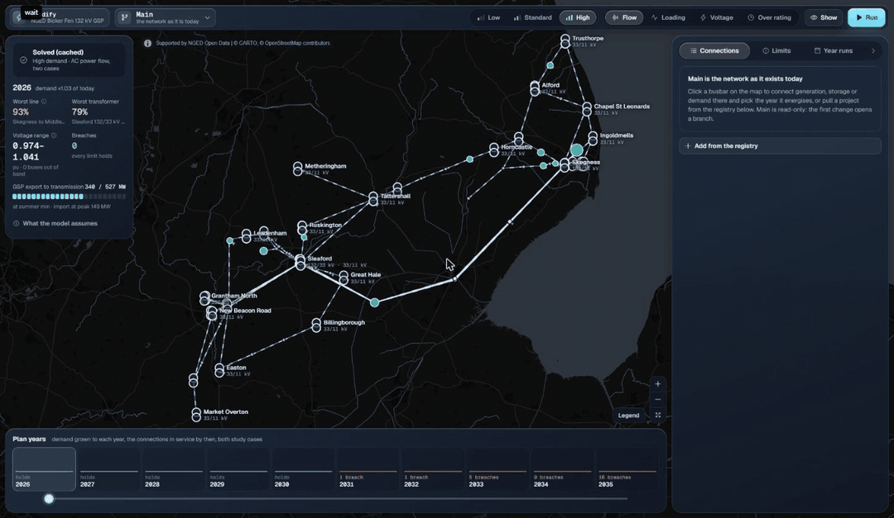

# Gridify

**A grid planning backbone: a real UK distribution network, AC power flow through the plan years, and branches to try changes on.**



*Today's network coloured by loading, then 2035, where demand growth breaches limits. Pulling a 248 MW battery from the registry opens a branch; every plan year is solved again, and Compare shows what it breaks against `main`: the worst line at 282% of its rating and the GSP's export over its 527 MW limit from 2026.*

Gridify models one real Grid Supply Point, **Bicker Fen 132 kV, Lincolnshire**, operated by National Grid Electricity Distribution (NGED), built entirely from open data. `main` is the network **as it exists today**. You open a branch, connect generation, storage or demand at a busbar and choose the year it energises, and the engine solves every plan year (2026 to 2035) with AC power flow in the two planning cases a DNO studies. Every year reports each line's and transformer's loading, every busbar's voltage, the GSP's export, and every limit breached, with its element, figure and case. You compare the branch with its parent year by year and merge it, or throw it away.

Stack: pandapower (power flow), Dagster + DuckDB (data pipeline), FastAPI (API), React + TypeScript + MapLibre (planner).

---

## Contents

- [Purpose](#purpose)
- [Status](#status)
- [Roadmap](#roadmap)
- [What you can do](#what-you-can-do)
- [The network and the data](#the-network-and-the-data)
- [How a year is solved](#how-a-year-is-solved)
- [Architecture](#architecture)
- [HTTP API](#http-api)
- [Quickstart](#quickstart)
- [Refreshing the data](#refreshing-the-data)
- [Tests](#tests)
- [Demand forecasting research](#demand-forecasting-research)
- [Sources and assumptions](docs/sources-and-assumptions.md) (separate document)
- [Limitations](#limitations)

---

## Purpose

Distribution networks in Great Britain are being asked to connect far more generation, storage and demand than they were
built for, and each request raises the same planning question: **in which year, on which line or transformer, and in
which operating condition does this connection push the network past a limit?** Answering it needs the network model, a
demand forecast per substation, the connections already accepted, and a power flow for every year of the plan.

Network operators do this in licensed desktop tools (PowerFactory, PSS/E) on their own models, one study at a time.
Gridify does it on public data, end to end: the network is rebuilt from NGED's published data, every input and
assumption is traceable to a source, the physics is deterministic, and alternative plans are kept as branches of today's
network that can be compared year by year and merged, the way code is. The aim is a planning engine an engineer can
audit line by line and that later work (learned demand and generation profiles, analysis on top of the results) can be
built on.

## Status

| Area | State |
|---|---|
| Network build, AC power flow, plan years 2026–2035, branches, comparison, merge | Working; the core of the product |
| Measured year: NGED's metered half-hourly flows for 2024 and 2025 run through the engine; grown to 2030 and 2035 | Working, read from saved run files; reports in `docs/reports/` |
| A second grid supply point (Staythorpe) | Built and studied as a report; not loaded in the planner |
| Day-ahead demand forecasting ([`forecast/`](forecast/README.md)) | Research, separate from the product; a held-out result exists |
| The measured-year work's modelling decisions ([decision log](docs/reports/decision-log-2026-11-13.md)) | Applied in the code; not yet reviewed as a set |

## Roadmap

- **A planning agent.** An AI agent that reads the solved years and the half-hourly flows, explains what binds, where,
  in which season and from which year, and suggests planning options: where and when a connection fits, which
  reinforcement or flexibility would clear a breach, and what each option changes. The engine stays the judge: every
  figure the agent quotes comes from a power flow, and every suggestion is a branch the engineer can run, compare and
  merge or discard.
- **Learned demand and generation profiles.** Plan years solved on forecast half-hourly profiles per substation instead
  of two snapshot cases, building on the [demand forecasting research](#demand-forecasting-research).
- **Security of supply.** N-1 contingency studies and planned outages, so a plan is judged with equipment out of service.
- **AI-assisted grid import.** Any operator's network, not only NGED's. An agent reads what the operator publishes (its
  long-term development statement, connection register, ratings and positions, in whatever layout it comes) and maps it
  into the warehouse's common format as a new asset group in the pipeline. The pipeline's checks then decide whether
  the result can be planned on: every reference resolves, the network is one connected piece, and its power flow
  converges in both study cases. Where the data is incomplete, the import asks or stops; nothing is guessed. Staythorpe,
  a second NGED supply point, is already built the same way by hand.

---

## What you can do

| | |
|---|---|
| **`main` = today** | The as-is network: the connected fleet, today's demand and the GSP. Nothing is pre-loaded for future years. `main` is read-only: it changes only by merging a branch into it. |
| **Branch** | Open a branch from `main` (or from another branch). Its connections and demand profile come along. |
| **Connect** | Click a busbar and place a connection there: technology, export (and import for storage or demand), the year it energises. Or pull a project from the registry (the not-yet-built sites NGED publishes), at its requested year. Change a connection's year or remove it at any time. |
| **Simulate** | Every edit re-runs the branch: each plan year is solved with demand grown to it (NGED's DFES projection per primary, on the Low, Standard or High pathway) and the connections in service by then. Years an edit does not touch come from the cache. |
| **Read the result** | The map colours loading or voltage for the year in view; the readings give the worst line and transformer, the voltage range and the GSP export against its limit; *Limits* lists every breach in the year and every element that breaches across the plan, with the first year it does; a selected element shows its figure in every year. |
| **Compare** | The branch against its parent, year by year, on the same demand profile: new and cleared breaches, the biggest loading movers, the GSP export change. The map shows the change in loading. |
| **Merge or discard** | Merging makes the branch's connections and profile its parent's. |

---

## The network and the data

All inputs are public. Each source is fetched by a script and bundled under `packages/optimizer/src/gridify_optimizer/data/nged/`. [Sources and assumptions](docs/sources-and-assumptions.md) lists every figure the engine uses and where it comes from.

| Data | Source | Used for |
|---|---|---|
| Circuits, transformers, demand, nodes, generation | NGED **Long Term Development Statement** (LTDS) tabular model, via the Connected Data Portal CKAN API | The pandapower network |
| Accepted-to-connect sites | NGED **Embedded Capacity Register** (ECR) | The project registry: location, connection voltage, export capacity, target date |
| Supergrid transformer limits | NGED *Bicker Fen Td Limits* (asset limits, transmission–distribution) | The GSP export limit, and the import limit per season (both SGTs) |
| Bicker Fen's demand at the GB winter peak | NESO **FES 2024 regional breakdown** (GSP `BICF_1`) | Today's winter-peak demand: 149.2 MW |
| Transmission projects at Bicker Fen | NESO **TEC Register** and **Interconnector Register** | Context, and one optional project that connects at the GSP |
| Substation positions | **OpenStreetMap**, © OpenStreetMap contributors, ODbL | Real coordinates for 29 of 68 substations. The rest (mostly line tee-points) sit between their neighbours |

NGED's own substation-location datasets are access-restricted, which is why positions come from OpenStreetMap.

**Supported by NGED Open Data.** NGED's datasets (the LTDS, the ECR, the DFES, the GSP limits and the half-hourly flows
below) are used under the *NGED Open Data Licence* (December 2020 version, based on the Open Government Licence v3.0),
which allows copying, adaptation and commercial use on condition that this statement appears wherever the data is used and
that nothing suggests NGED endorses Gridify. NGED gives no warranty for the data. The planner shows the statement in the
map's attribution.

**Building today's network** (`gridify_optimizer/nged.py`):
- Rows the LTDS marks **Removed** are dropped. The LTDS flags every row against NGED's previous edition, and a replaced transformer appears once as *Removed* and once as *New*.
- Switches and zero-impedance links are merged into single buses.
- Impedances are converted from %Z on a 100 MVA base.
- Demand is each substation's LTDS maximum, scaled to what is on at the GSP's winter peak by two published figures: each BSP's own maximum (its primaries don't all peak together) and NESO's peak for Bicker Fen GSP, 149.2 MW. No assumed diversity factor. A BSP's own Table 3 rows ("Sleaford (GT1)", "(GT2)") are the group demand its 132/33 kV transformers carry, the same customers as the primaries listed under it, so they add no load. The summer minimum is each row's maximum × its LTDS minimum-demand factor.
- The 132 kV busbar is the transmission infeed.
- The 14 connected generators of LTDS Table 5 sit at the substations NGED names for them, at their connection voltage (a site at a double-busbar substation is shared across its sections; the sections themselves are joined only where the LTDS lists a connector, see [Sources and assumptions](docs/sources-and-assumptions.md)). Where Table 5 gives a BSP-level total, the 11 sites the Embedded Capacity Register names at their own feeders sit on those feeders (`BICKER_FEN.generation_sites` (`nged_points`)), and one connected site that this LTDS edition predates, Ash Farm (48 MW of solar, 2025), sits at Bicker Fen 132 kV (`BICKER_FEN.ecr_additions` (`nged_points`)).
- Every transformer carries its LTDS tap range as an on-load tap changer; the solver regulates the taps so each 33 kV and 11 kV busbar is held near 1.02 pu, as the real AVC relays do (the target is an assumption: LTDS doesn't publish it).

The result has **139 buses, 128 lines, 44 transformers and 149 MW of demand at winter peak**. It solves in both study cases with every bus inside its statutory band; the worst element is the pair of 132 kV circuits carrying the Middlemarsh offshore wind to Skegness, at 93% at summer minimum, and the lowest voltage is Horncastle 33 kV at the end of a long feeder, 0.98 pu at winter peak. Today the region **exports ~340 MW up to the transmission system** at summer minimum, because it generates more than it uses.

Against NGED's own load flow over the metered year 2024 the engine's maxima on the Bicker Fen–Boston circuit are within 3 MW of NGED's (86 against 85 MW towards the GSP, 30 against 27 MW towards Boston); the comparison and its caveats are in [Sources and assumptions](docs/sources-and-assumptions.md#comparison-with-ngeds-half-hourly-flows).

---

## How a year is solved

A plan year is today's network with demand grown to that year and every connection whose year has arrived. It is solved in two study cases:

- **Winter peak**: grown demand, winter thermal ratings, solar and wind at nil, batteries charging at their import capacity, demand connections drawing their full import.
- **Summer minimum**: the LTDS minimum demand (measured, not grown), summer ratings, every generator at full export, demand connections drawing half their import.

These are the two planning conditions the SQSS sets at the interface with a distribution network, and the two headroom studies every DNO's Network Development Plan publishes (peak against capacity; all generation at minimum demand); [Sources and assumptions](docs/sources-and-assumptions.md) cites them. The on-load tap changers are regulated in each case before anything is judged.

The limits, in both cases:
- every busbar inside its **statutory voltage band**: ±10% at 132 kV, ±6% at 33 kV and 11 kV (GB ESQCR);
- every line and transformer at or below 100% of its rating for the season;
- **the GSP exporting no more than its supergrid transformers allow**: 2 × 263.5 MW = 527 MW.

A year reports every breach in every case, the worst figure of the two cases for each element (and which case set it), the GSP's export and import, and whether the power flow has a valid operating point: one that did not converge, or converged to a voltage collapse (a busbar below 0.5 pu, see *Voltage-collapse floor* in [Sources and assumptions](docs/sources-and-assumptions.md)), is reported as having none, with no loadings. Nothing is a gate: the plan is reported as it stands, every year.

**Technologies.**
- **Solar, wind**: nil at winter peak, full export at summer minimum.
- **Battery, hybrid (solar + battery)**: charging at its import capacity at winter peak, full export at summer minimum.
- **Demand, electrolyser** (import-only): export nothing; their import at winter peak, half of it at summer minimum (an assumption).
- **Gas, gas engines, biomass and anything unclassified**: firm, full output in both cases.

A connection runs at unity power factor unless its control mode says otherwise (a fixed power factor, or voltage control within a reactive range).

Engine details: [`packages/optimizer/README.md`](packages/optimizer/README.md).

---

## Architecture

```
apps/pipeline   Dagster: the pinned LTDS / ECR / OSM / DFES snapshot -> the DuckDB warehouse (read-only for the API)
packages/optimizer   gridify_optimizer: the network build (nged.py), the physics (network.py), the plan years (years.py), the comparison (diff.py)
apps/api        FastAPI on :8000: the grid, branches and their connections, runs as background jobs, the result cache, the comparison
apps/web        Vite + React + TypeScript planner on :3000: the map, the readings, the timeline, the side panel
forecast        standalone research: day-ahead demand forecasting at a primary substation (not imported by the app)
docs/reports    (index: docs/reports/README.md) the studies behind the engine's choices: the measured and grown years, firm capacity, a second GSP (Staythorpe)
```

- The engine is the single source of truth for the physics; the API and the planner never duplicate it.
- The API keeps everything a user does in its own scenarios store (DuckDB by default, Postgres with `GRIDIFY_SCENARIOS_URL`), never in the warehouse.
- Every result is cached under the grid's snapshot, the demand profile, the connections and the engine's code fingerprint, in process and durably; plan years are cached one by one, so an edit re-solves only the years it changes.
- One power flow runs at a time in the API process (one job worker and one solver lock).

---

## HTTP API

FastAPI on :8000; the endpoint list is in [`apps/api/README.md`](apps/api/README.md), and the running API serves interactive documentation at http://localhost:8000/docs.

---

## Quickstart

**Prerequisites:** Node 22 + pnpm 10, Python 3.11+ with [uv](https://docs.astral.sh/uv/). No API key is needed.

```bash
pnpm install                                   # JS deps (monorepo root)

# build the warehouse from the bundled data (runs the Dagster asset graph + checks)
cd apps/pipeline
uv run dagster asset materialize -m grid_simulator.definitions --select 'ltds_tables*'
cd ../..

# run the app: two terminals, from the repo root
pnpm --filter @gridify/api dev               # API on http://localhost:8000
pnpm --filter web dev                          # planner on http://localhost:3000
```

Open **http://localhost:3000**. You land on `main`, today's network, already solved. Click a busbar and add a connection: `main` is read-only, so the first change opens a branch for it, and the branch re-runs by itself. Pick a year on the timeline, read *Limits*, and open *Compare* to see what the branch changes against `main`.

- **Shell quoting:** quote `'ltds_tables*'`, or the shell may expand it. It selects the root asset and everything downstream.
- **Dagster UI:** `uv run dg dev` shows lineage and check results. It also uses port 3000, so don't run it alongside the web app.
- **Postgres (optional):** `GRIDIFY_SCENARIOS_URL=postgresql://user@host:5432/dbname` before starting the API moves the scenarios store to Postgres.

## Refreshing the data

The bundled data is a pinned snapshot; adopting a newer edition of NGED's registers, or fetching the half-hourly flows for the measured year, is a deliberate step described in [`apps/pipeline/README.md`](apps/pipeline/README.md#refreshing-the-data).

---

## Tests

```bash
pnpm test                                     # everything, via Turborepo
cd packages/optimizer && uv run pytest -q     # engine (4 workers): the physics, the cases, the plan years, the NGED data rules, the editions, the CIM export
cd apps/api && uv run --with pytest pytest tests -q   # API (a temp scenarios DB; +1 against Postgres if GRIDIFY_TEST_PG_URL is set)
```

The engine tests are **grid-agnostic**: fixtures are derived from whatever network `build_base_net()` returns, never from hard-coded bus ids. `test_nged.py` holds the NGED data rules (removed equipment is excluded, every live MW of demand is modelled, no registry project is pre-loaded). The planner has no unit tests; it is checked in a real browser.

---

## Demand forecasting research

[`forecast/`](forecast/README.md) is a separate research project: day-ahead, half-hourly demand forecasting at a real primary substation (Newmarket, UK Power Networks) from its own history, the calendar and the weather forecast as issued the morning before. The method, hypotheses and success criterion were fixed before any result, and the held-out year (2025) was run once: the best model (a GAM and LightGBM average with forecast temperature) scores 4.20% NMAE (normalised mean absolute error) against 5.46% for the best model without weather, 23% lower. It is the groundwork for solving plan years on learned profiles (see [Roadmap](#roadmap)).

---

## Limitations

- **The GSP's export and import limits (both SGTs in service) are the only transmission constraints modelled.** The 400 kV network, wider transmission boundaries and the loss of one SGT are not.
- **Two snapshot cases per year, not a time series.** Each year is its winter peak and its summer minimum; how many hours an element is over its limit, or how often, is not modelled in the plan years. One measured year (2024, NGED's half-hourly flows) has been run through the engine, and grown to 2030 and 2035 demand, as reports (`docs/reports/measured-year-2024/report.md`, `docs/reports/grown-year-2026-11-13/report.md`); the planner's *Year runs* tab reads the saved runs, but no plan year is solved that way.
- **Generation dispatch per case is a planning assumption.** PV and wind at nil and batteries charging at winter peak; everything at full export at summer minimum; demand projects at 50% of their import at summer minimum.
- **Tap-changer settings are assumed.** The LTDS gives each transformer's tap range but not its step or its target voltage; 1.25% per tap is used, regulated towards 1.02 pu with a ±0.01 pu deadband. Line-drop compensation is not modelled.
- **Intact network only.** No N-1 or planned outages: every year is studied with everything in service. Bus sections run split and the 33 kV network meshed, as the LTDS lists them (NGED publishes the connectivity, not the running arrangement), flagged per element in the model's assumptions.
- **The GSP limit's direction is an assumption.** NGED's dataset doesn't document its sign convention; we read "export" as distribution to transmission.
- **One grid.** The network is NGED Bicker Fen, behind the `GridSource` seam; importing another grid is not built.
- **The previous LTDS edition is reconstructed, not fetched.** NGED's New/Removed flags give it exactly, but Updated rows carry their current values in both editions.
